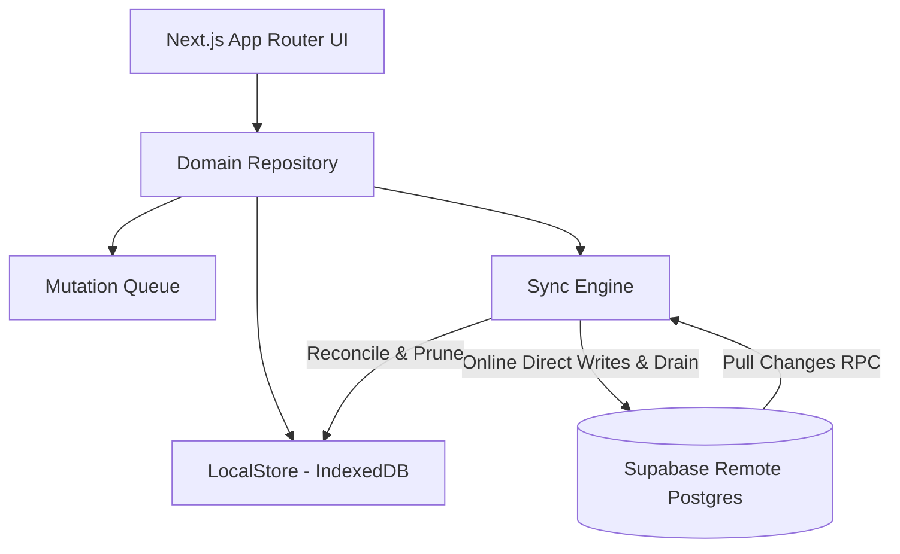

# Architecture & System Invariants

## 1. Architectural Philosophy

Clearcut is built around an **online-first architecture with offline resilience** and strict **zero-sum ledger** principles:
- **Online-First Direct Writes**: When a device has an active internet connection, mutations (creating/editing expenses, settlements, group creations) write directly to Supabase RPCs and PostgreSQL tables. This prevents discrepancy between local cache and the remote database.
- **Offline Resilience Fallback**: If the network is disconnected, mutations are enqueued into local storage, the user is notified with a clear prompt (`"No network connection. Saved locally — will sync when online."`), and changes automatically drain to Supabase upon reconnection.
- **Client**: Next.js 16 (App Router) exported statically (`output: 'export'`) running within a Capacitor 8 Native WebView.
- **Backend**: Supabase (PostgreSQL 15+, Row Level Security, Custom RPCs, Edge Functions, Realtime).
- **Local Storage**: IndexedDB (via local repository abstraction) for offline caching and queue persistence.

---

## 2. Mathematical Invariants

Clearcut enforces 5 strict invariants across both client calculations and Postgres stored procedures:

### Invariant 1: Integer Minor Units Only
- Floating-point representations (e.g. `12.50`) are **strictly prohibited** in storage, state, and API layers.
- All monetary amounts are handled as `BIGINT` representing the currency minor unit (e.g., cents for USD/EUR, paise for INR).
- Conversion functions: `toMinorUnits(amount, currency)` and `formatMinorUnits(minorUnits, currency)`.

### Invariant 2: Zero-Sum Expense Conservation
For every individual expense:
$$\sum \text{paid\_minor} = \text{amount\_minor} = \sum \text{owed\_minor}$$
Any calculation or split algorithm that leaves a rounding remainder distributes the remaining minor units according to a deterministic algorithm (e.g., highest owed member first).

### Invariant 3: Zero-Sum Group Balances
Across every group:
$$\sum_{m \in \text{Members}} \text{net\_balance}(m) = 0$$
No money can be created or destroyed within a ledger.

### Invariant 4: Mutation Idempotency
Every mutating operation generates a client-side UUID (`client_mutation_id`). Retrying mutations (due to connection loss or timeout) returns the original result without duplicate charges.

### Invariant 5: Optimistic Concurrency Control (OCC)
Mutations pass a `base_version` parameter. If concurrent updates occurred on the server:
- Postgres raises custom SQLSTATE `PT409` (`EXPENSE_CONFLICT`).
- Server returns the current row in `DETAIL` for client-side three-way merge resolution.

---

## 3. Technology Stack

- **Framework**: Next.js 16 (App Router, Turbopack, static export)
- **Styling**: Tailwind CSS with Neo-Brutalist design system (high-contrast borders, solid shadows, bold typography)
- **Native Runtime**: Capacitor 8 (Android + iOS)
- **Database & Auth**: Supabase Postgres + Supabase Auth (6-digit OTP phone/email + Google OAuth)
- **Push Notifications**: Firebase Cloud Messaging (FCM) HTTP v1 API
- **Testing**: Vitest + `fast-check` (property-based invariant testing)
