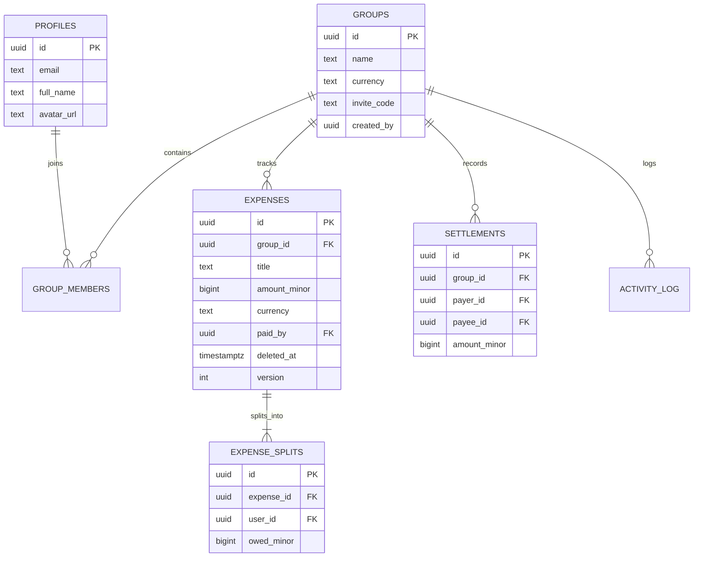

# Database & Migrations Guide

Clearcut relies on **Supabase (PostgreSQL 15+)** with strict Row Level Security (RLS) policies and transaction-safe stored procedures (RPCs).

---

## 1. Schema Overview



---

## 2. Core RPC Functions

| Function | Purpose |
| :--- | :--- |
| `create_group_v1` | Atomically provisions group, adds owner as active member, generates invite code |
| `join_group_v1` | Verifies invite code, auto-provisions profile if missing, joins member |
| `delete_group_v1` | Permanently cascades and purges group and dependent records |
| `upsert_expense_v1` | Atomically creates or updates expense and splits; checks invariants and OCC version |
| `record_settlement_v1` | Records debt settlement payment between two members |
| `pull_changes_v1` | Incremental/Full sync pull returning active groups, expenses, and members |

---

## 3. Migration Workflow

All migrations live under `supabase/migrations/`:

```bash
# 1. Create a new migration file
npx supabase migration new your_feature_name

# 2. Check diff against remote database
npx supabase db diff

# 3. Push migrations to remote Supabase project
npx supabase db push

# 4. View applied migration list
npx supabase migration list
```

> **Warning:** Never edit applied migrations in place. Always write a forward migration with an incremental prefix (e.g. `0021_...sql`).
