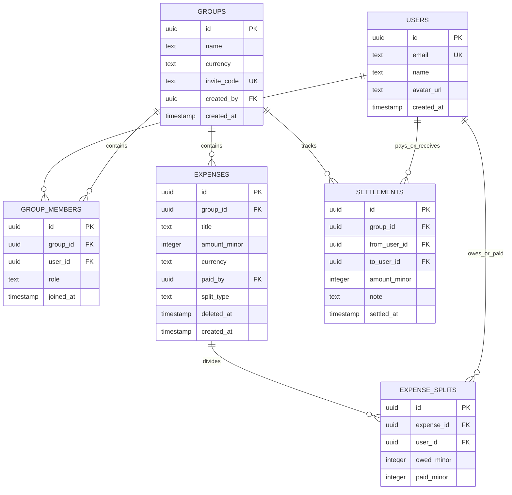

# Splitwise Clone: Comprehensive Architecture & Expense Settling Specification

> **Target Audience**: AI Coding Agents & Full-Stack Engineers  
> **Status**: Ready for Production Implementation  
> **Core Focus**: Non-floating point monetary precision, multi-payer split mechanics, ledger-based partial settlements, and greedy debt simplification algorithms ($O(N \log N)$ min-transactions).

---

## 1. System Overview & Product Scope

The application is a collaborative group expense sharing and debt settlement platform (Splitwise clone). It enables groups of friends, roommates, or trip companions to log group expenses, split costs with custom rules, track running net balances, and settle debts with the minimal number of payments.

### Key Capabilities
1. **Groups & Membership**: Manage groups, invite members, assign roles (`owner`, `member`, `viewer`).
2. **Flexible Expense Splitting**:
   - **Equal Split**: Automatically distributed with exact single-unit remainder absorption.
   - **Exact / Custom Split**: Absolute amounts per member verified to equal total.
   - **Percentage Split**: Custom percentages verified to sum to 100%, rounding differences absorbed by the final participant.
   - **Multi-Payer Expenses**: Support multiple payers contributing varying amounts toward a single expense.
3. **Ledger-Based Settlement Engine**:
   - Uses an append-only settlement ledger instead of fragile boolean `is_settled` flags on individual splits.
   - Supports partial settlements, lump-sum settlements, and cross-expense balancing.
4. **Optimal Debt Simplification**:
   - Reduces complex $N$-party web of pairwise debts into at most $N - 1$ minimal cash-flow transactions using a greedy two-pointer matching algorithm.
5. **Real-Time Collaboration**:
   - WebSocket broadcast of expense creation, updates, soft-deletions, and settlements for optimistic UI synchronization.
6. **Zero Floating-Point Error Guarantee**:
   - All arithmetic strictly operates on integer minor units (e.g., cents, paise). Display decimals are calculated only at render time.

---

## 2. The Golden Rules of Monetary Engineering

```
┌────────────────────────────────────────────────────────────────────────┐
│                   THE THREE INVARIANTS OF MONEY                        │
├────────────────────────────────────────────────────────────────────────┤
│ 1. NEVER store or calculate money using IEEE 754 floats / doubles.     │
│    $10.00 is stored as 1000 (integer minor units).                     │
│ 2. Conservation of Money Invariant:                                    │
│    Σ(paidMinor) === expense.amountMinor === Σ(owedMinor)               │
│ 3. Global Balance Invariant:                                           │
│    Σ(all member net balances across group) === 0                       │
└────────────────────────────────────────────────────────────────────────┘
```

Floating-point representations lead to errors like `0.1 + 0.2 === 0.30000000000000004`. Over hundreds of transactions, pennies drift, leading to unreconcilable balance sheets.

### Minor Unit Mapping
| Currency | Minor Unit | Scale Factor | Example (Major) | Stored Integer |
| :--- | :--- | :--- | :--- | :--- |
| USD | Cents | 100 | $42.50 | `4250` |
| EUR | Cents | 100 | €19.99 | `1999` |
| INR | Paise | 100 | ₹1,250.75 | `125075` |
| JPY | Yen | 1 | ¥5,000 | `5000` |

---

## 3. Database Schema

Here is the production schema using PostgreSQL (compatible with Drizzle ORM, Prisma, or Raw SQL).

### Entity Relationship Diagram (ERD)



### PostgreSQL DDL Definition

```sql
CREATE TABLE users (
    id UUID PRIMARY KEY DEFAULT gen_random_uuid(),
    email TEXT NOT NULL UNIQUE,
    name TEXT NOT NULL,
    avatar_url TEXT,
    created_at TIMESTAMPTZ NOT NULL DEFAULT NOW()
);

CREATE TABLE groups (
    id UUID PRIMARY KEY DEFAULT gen_random_uuid(),
    name TEXT NOT NULL,
    currency VARCHAR(3) NOT NULL DEFAULT 'USD',
    invite_code VARCHAR(16) UNIQUE NOT NULL,
    created_by UUID NOT NULL REFERENCES users(id) ON DELETE CASCADE,
    created_at TIMESTAMPTZ NOT NULL DEFAULT NOW()
);

CREATE TABLE group_members (
    id UUID PRIMARY KEY DEFAULT gen_random_uuid(),
    group_id UUID NOT NULL REFERENCES groups(id) ON DELETE CASCADE,
    user_id UUID NOT NULL REFERENCES users(id) ON DELETE CASCADE,
    role VARCHAR(20) NOT NULL DEFAULT 'member', -- 'owner' | 'admin' | 'member'
    joined_at TIMESTAMPTZ NOT NULL DEFAULT NOW(),
    CONSTRAINT unique_group_user UNIQUE(group_id, user_id)
);

CREATE TABLE expenses (
    id UUID PRIMARY KEY DEFAULT gen_random_uuid(),
    group_id UUID NOT NULL REFERENCES groups(id) ON DELETE CASCADE,
    title TEXT NOT NULL,
    amount_minor INTEGER NOT NULL CHECK (amount_minor > 0),
    currency VARCHAR(3) NOT NULL DEFAULT 'USD',
    paid_by UUID NOT NULL REFERENCES users(id) ON DELETE CASCADE,
    split_type VARCHAR(20) NOT NULL CHECK (split_type IN ('equal', 'custom', 'percentage')),
    deleted_at TIMESTAMPTZ, -- Soft delete retains history, excludes from balances
    created_at TIMESTAMPTZ NOT NULL DEFAULT NOW()
);

CREATE INDEX expenses_group_id_idx ON expenses(group_id) WHERE deleted_at IS NULL;

CREATE TABLE expense_splits (
    id UUID PRIMARY KEY DEFAULT gen_random_uuid(),
    expense_id UUID NOT NULL REFERENCES expenses(id) ON DELETE CASCADE,
    user_id UUID NOT NULL REFERENCES users(id) ON DELETE CASCADE,
    owed_minor INTEGER NOT NULL DEFAULT 0 CHECK (owed_minor >= 0),
    paid_minor INTEGER NOT NULL DEFAULT 0 CHECK (paid_minor >= 0),
    CONSTRAINT unique_expense_user UNIQUE(expense_id, user_id)
);

CREATE TABLE settlements (
    id UUID PRIMARY KEY DEFAULT gen_random_uuid(),
    group_id UUID NOT NULL REFERENCES groups(id) ON DELETE CASCADE,
    from_user_id UUID NOT NULL REFERENCES users(id) ON DELETE CASCADE,
    to_user_id UUID NOT NULL REFERENCES users(id) ON DELETE CASCADE,
    amount_minor INTEGER NOT NULL CHECK (amount_minor > 0),
    note TEXT,
    settled_at TIMESTAMPTZ NOT NULL DEFAULT NOW()
);

CREATE INDEX settlements_group_id_idx ON settlements(group_id);
```

---

## 4. Pure Split Mathematics & Rounding Algorithms

When splitting an odd number among $N$ people, division has remainders. For example:
- Split $100.00 (`10000` cents) among 3 people.
- $10000 \div 3 = 3333$ with remainder $1$.
- Members receive `3334`, `3333`, `3333`. Sum is exactly `10000`.

### 4.1 Equal Split Algorithm

```typescript
/**
 * Distributes `totalMinor` minor units equally among `memberCount` members.
 * Any remainder minor units are assigned 1-each to the first members in order,
 * ensuring the shares sum exactly to `totalMinor`.
 */
export function calculateEqualSplitMinor(totalMinor: number, memberCount: number): number[] {
  if (memberCount <= 0) return [];

  const base = Math.floor(totalMinor / memberCount);
  const remainder = totalMinor - base * memberCount;

  const splits: number[] = [];
  for (let i = 0; i < memberCount; i++) {
    splits.push(base + (i < remainder ? 1 : 0));
  }
  return splits;
}
```

### 4.2 Percentage Split Algorithm

Percentages can introduce rounding issues (e.g. 33.33% of 100). The final participant absorbs the rounding delta to prevent pennies leaking.

```typescript
/**
 * Computes owed shares from percentages.
 * Each share is rounded to the nearest integer minor unit;
 * any cumulative rounding difference is absorbed into the last participant.
 */
export function calculatePercentageSplitMinor(totalMinor: number, percentages: number[]): number[] {
  if (percentages.length === 0) return [];

  const splits: number[] = [];
  let assigned = 0;

  for (let i = 0; i < percentages.length; i++) {
    if (i === percentages.length - 1) {
      splits.push(totalMinor - assigned);
    } else {
      const share = Math.round((totalMinor * percentages[i]) / 100);
      assigned += share;
      splits.push(share);
    }
  }
  return splits;
}

/** Validates that percentages sum to 100 within a 0.01 tolerance */
export function validatePercentageSplit(percentages: number[]): boolean {
  const sum = percentages.reduce((acc, p) => acc + p, 0);
  return Math.abs(sum - 100) < 0.01;
}
```

### 4.3 Custom / Exact Split Validation

```typescript
export function sumMinor(values: number[]): number {
  return values.reduce((acc, v) => acc + v, 0);
}

export function validateCustomSplitMinor(totalMinor: number, owedShares: number[]): boolean {
  return sumMinor(owedShares) === totalMinor;
}
```

---

## 5. Multi-Payer Assembly & Invariant Verification

Real-world groups often have situations where Alice pays $60 and Bob pays $40 for a $100 dinner.

### Core Invariants Enforced on Every Expense:
1. $\sum \text{owedMinor} = \text{expense.amountMinor}$
2. $\sum \text{paidMinor} = \text{expense.amountMinor}$

```typescript
export interface PayerInput {
  userId: string;
  paidMinor: number;
}

export interface SplitRow {
  userId: string;
  owedMinor: number;
  paidMinor: number;
}

export function resolvePaidShares(
  amountMinor: number,
  paidBy?: string,
  payers?: PayerInput[]
): { primaryPayerId: string; payers: PayerInput[] } | { error: string } {
  if (payers && payers.length > 0) {
    if (sumMinor(payers.map((p) => p.paidMinor)) !== amountMinor) {
      return { error: 'EXPENSE_INVALID_SPLIT: sum of paid shares must equal expense total' };
    }
    // Deterministic primary payer is the largest contributor
    const sorted = [...payers].sort((a, b) => b.paidMinor - a.paidMinor);
    return { primaryPayerId: sorted[0].userId, payers };
  }

  if (paidBy) {
    return {
      primaryPayerId: paidBy,
      payers: [{ userId: paidBy, paidMinor: amountMinor }],
    };
  }

  return { error: 'EXPENSE_INVALID_SPLIT: no payer specified' };
}
```

---

## 6. The Balance Aggregation Engine

### Why Boolean `is_settled` Flags Fail
In naive designs, each split row has `is_settled: boolean`. This pattern fails completely when:
1. **Partial Payments**: Bob owes $75 but pays $50 today. You cannot mark the split row as settled.
2. **Cross-Expense Payments**: Bob owes on 3 separate expenses totaling $100 and hands Alice a $100 bill. Tying that to 3 separate rows requires complicated transactional locks.
3. **Expense Edits**: If an old expense is adjusted, reverting granular settled flags becomes messy.

### The Ledger-Derived Balance Solution
All active expenses and settlements form an append-only ledger. A member's net balance is derived on-demand:

$$\text{NetBalance}_u = \sum \text{paidMinor}_u - \sum \text{owedMinor}_u + \sum_{\text{settledAsPayer}} \text{amountMinor} - \sum_{\text{settledAsRecipient}} \text{amountMinor}$$

- **Positive Balance ($> 0$)**: The user is a **creditor** (they are owed money).
- **Negative Balance ($< 0$)**: The user is a **debtor** (they owe money).
- **Zero Balance ($= 0$)**: Completely squared away.

```typescript
export async function getGroupBalances(groupId: string): Promise<Map<string, number>> {
  // 1. Fetch non-deleted expenses
  const activeExpenses = await db
    .select()
    .from(expenses)
    .where(and(eq(expenses.groupId, groupId), isNull(expenses.deletedAt)));

  const balances = new Map<string, number>();
  const bump = (userId: string, delta: number) => {
    balances.set(userId, (balances.get(userId) ?? 0) + delta);
  };

  // 2. Aggregate expense splits
  for (const exp of activeExpenses) {
    const splits = await db
      .select()
      .from(expenseSplits)
      .where(eq(expenseSplits.expenseId, exp.id));

    for (const split of splits) {
      // Net contribution = what you paid minus what you consumed
      bump(split.userId, split.paidMinor - split.owedMinor);
    }
  }

  // 3. Fold in recorded settlements
  const groupSettlements = await db
    .select()
    .from(settlements)
    .where(eq(settlements.groupId, groupId));

  for (const st of groupSettlements) {
    // Payer sent money -> their balance moves positively (closer to zero if negative)
    bump(st.fromUserId, st.amountMinor);
    // Recipient received money -> their balance moves negatively (closer to zero if positive)
    bump(st.toUserId, -st.amountMinor);
  }

  return balances;
}
```

---

## 7. Debt Simplification Algorithm (`simplifyDebts`)

In a group of 5 people, without simplification, there can be up to $\frac{5 \times 4}{2} = 10$ pairwise debts. By applying greedy bipartite cash-flow matching, the debt graph is simplified to at most $N - 1$ total transactions ($4$ transactions).

### Complexity
- **Time**: $O(K \log K)$ where $K \le N$ is the number of members with non-zero balances.
- **Space**: $O(K)$

### Algorithm Mechanics
1. Partition members into **Creditors** (positive balance) and **Debtors** (negative balance).
2. Sort creditors descending by amount.
3. Sort debtors descending by absolute owed amount.
4. Use two pointers ($i$ for creditor, $j$ for debtor):
   - Let $\text{settleAmount} = \min(\text{creditor}_i, \text{debtor}_j)$.
   - Emit transaction: `debtor[j] -> creditor[i] for settleAmount`.
   - Subtract $\text{settleAmount}$ from both.
   - Advance $i$ if creditor is 0; advance $j$ if debtor is 0.

### TypeScript Implementation

```typescript
export interface SettlementTransaction {
  from: string; // debtor userId
  to: string;   // creditor userId
  amountMinor: number;
  currency: string;
}

export function simplifyDebts(
  balances: Map<string, number>,
  currency = 'USD'
): SettlementTransaction[] {
  const transactions: SettlementTransaction[] = [];

  const creditors: { userId: string; amount: number }[] = [];
  const debtors: { userId: string; amount: number }[] = [];

  for (const [userId, balance] of balances) {
    if (balance > 0) {
      creditors.push({ userId, amount: balance });
    } else if (balance < 0) {
      debtors.push({ userId, amount: -balance });
    }
  }

  // Sort descending by magnitude for deterministic greedy matching
  creditors.sort((a, b) => b.amount - a.amount);
  debtors.sort((a, b) => b.amount - a.amount);

  let i = 0; // creditor index
  let j = 0; // debtor index

  while (i < creditors.length && j < debtors.length) {
    const settleAmount = Math.min(creditors[i].amount, debtors[j].amount);

    transactions.push({
      from: debtors[j].userId,
      to: creditors[i].userId,
      amountMinor: settleAmount,
      currency,
    });

    creditors[i].amount -= settleAmount;
    debtors[j].amount -= settleAmount;

    if (creditors[i].amount === 0) i++;
    if (debtors[j].amount === 0) j++;
  }

  return transactions;
}
```

---

## 8. API Specification

All endpoints are scoped under `/api/groups/:groupId/`.

### 8.1 Create Expense
- **Endpoint**: `POST /api/groups/:groupId/expenses`
- **Request Body**:
```json
{
  "title": "Cabin Airbnb",
  "amountMinor": 30000,
  "currency": "USD",
  "paidBy": "user-alice-uuid",
  "splitType": "equal"
}
```
*Or Multi-Payer / Custom Split:*
```json
{
  "title": "Group Grocery Haul",
  "amountMinor": 10000,
  "currency": "USD",
  "payers": [
    { "userId": "user-alice-uuid", "paidMinor": 6000 },
    { "userId": "user-bob-uuid", "paidMinor": 4000 }
  ],
  "splitType": "custom",
  "customSplits": [
    { "userId": "user-alice-uuid", "owedMinor": 2500 },
    { "userId": "user-bob-uuid", "owedMinor": 2500 },
    { "userId": "user-charlie-uuid", "owedMinor": 5000 }
  ]
}
```
- **Response `(201 Created)`**:
```json
{
  "expense": {
    "id": "exp-uuid",
    "groupId": "group-uuid",
    "title": "Group Grocery Haul",
    "amountMinor": 10000,
    "currency": "USD",
    "paidBy": "user-alice-uuid",
    "splitType": "custom",
    "createdAt": "2026-10-10T12:00:00Z"
  },
  "splits": [
    { "id": "s1", "userId": "user-alice-uuid", "owedMinor": 2500, "paidMinor": 6000 },
    { "id": "s2", "userId": "user-bob-uuid", "owedMinor": 2500, "paidMinor": 4000 },
    { "id": "s3", "userId": "user-charlie-uuid", "owedMinor": 5000, "paidMinor": 0 }
  ]
}
```

### 8.2 Get Balances & Summary
- **Endpoint**: `GET /api/groups/:groupId/balances`
- **Response `(200 OK)`**:
```json
{
  "summary": {
    "totalMinor": 40000,
    "memberBalances": [
      { "userId": "user-alice-uuid", "balanceMinor": 3500 },
      { "userId": "user-bob-uuid", "balanceMinor": 1500 },
      { "userId": "user-charlie-uuid", "balanceMinor": -5000 }
    ],
    "settlements": [
      {
        "from": "user-charlie-uuid",
        "to": "user-alice-uuid",
        "amountMinor": 3500,
        "currency": "USD"
      },
      {
        "from": "user-charlie-uuid",
        "to": "user-bob-uuid",
        "amountMinor": 1500,
        "currency": "USD"
      }
    ]
  }
}
```

### 8.3 Record Settlement
- **Endpoint**: `POST /api/groups/:groupId/settlements`
- **Request Body**:
```json
{
  "fromUserId": "user-charlie-uuid",
  "toUserId": "user-alice-uuid",
  "amountMinor": 3500,
  "note": "Venmo transfer"
}
```
- **Response `(201 Created)`**:
```json
{
  "settlement": {
    "id": "st-uuid",
    "groupId": "group-uuid",
    "fromUserId": "user-charlie-uuid",
    "toUserId": "user-alice-uuid",
    "amountMinor": 3500,
    "note": "Venmo transfer",
    "settledAt": "2026-10-10T12:30:00Z"
  }
}
```

### 8.4 Soft Delete Expense
- **Endpoint**: `DELETE /api/groups/:groupId/expenses/:expenseId`
- **Response `(200 OK)`**:
```json
{ "deleted": true }
```

---

## 9. Real-Time WebSocket Events & Optimistic Updates

Whenever an expense or settlement is created, updated, or deleted, the server broadcasts an event to the group's WebSocket room (`group:{groupId}`):

| Event | Payload | Purpose |
| :--- | :--- | :--- |
| `expense:created` | `{ expense, splits, userId }` | Add to feed, recalculate local balances |
| `expense:updated` | `{ expense, splits, userId }` | Update row, recalculate balances |
| `expense:deleted` | `{ expenseId, userId }` | Remove row, recalculate balances |
| `expense:settled` | `{ settlement, userId }` | Add payment to history, deduct from debt |

### Client Optimistic Hook Pattern
Clients generate a temporary UUID, immediately update React state, and rollback if the API rejects the request:
```typescript
// Optimistic settle up handler
async function handleRecordPayment(draft: PaymentDraft) {
  // 1. Snapshot previous state
  const prevSummary = summary;
  
  // 2. Optimistically adjust local balance
  setSummary((curr) => {
    if (!curr) return null;
    return {
      ...curr,
      memberBalances: curr.memberBalances.map((mb) => {
        if (mb.userId === draft.fromUserId) return { ...mb, balanceMinor: mb.balanceMinor + draft.amountMinor };
        if (mb.userId === draft.toUserId) return { ...mb, balanceMinor: mb.balanceMinor - draft.amountMinor };
        return mb;
      })
    };
  });

  // 3. Fire API
  const ok = await apiRecordSettlement(draft);
  if (!ok) {
    // Rollback
    setSummary(prevSummary);
  }
}
```

---

## 10. Frontend UI / UX Guidelines

### Perspective-Aware Display
Always tailor the view to the logged-in user:
- If `balance > 0`: Display in **Green** / Success styling: *"You are owed $35.00"*.
- If `balance < 0`: Display in **Orange/Red** / Danger styling: *"You owe $50.00"*.
- If `balance === 0`: Display in **Neutral / Muted** styling: *"You are all settled up"*.

### "Settle Up" Modal Essentials
1. Pre-fill the exact suggested amount from `simplifyDebts`.
2. Allow editing for **partial payments** (e.g. pay $20 now instead of $50).
3. Display payment methods (Venmo, PayPal, UPI, Cash) as optional note tags.

### Formatting Utility

```typescript
export function formatMoneyMinor(amountMinor: number, currency = 'USD'): string {
  const major = amountMinor / 100;
  return new Intl.NumberFormat('en-US', {
    style: 'currency',
    currency,
    minimumFractionDigits: 2,
    maximumFractionDigits: 2,
  }).format(major);
}
```

---

## 11. Comprehensive Vitest / Jest Test Suite

Export these exact unit tests to verify the engine before running the UI.

```typescript
import { describe, it, expect } from 'vitest';
import {
  calculateEqualSplitMinor,
  calculatePercentageSplitMinor,
  sumMinor,
  simplifyDebts,
} from './expense-engine';

describe('Splitwise Engine Core Tests', () => {
  describe('Split Remainder Conservation', () => {
    it('distributes 10000 cents among 3 members without losing pennies', () => {
      const splits = calculateEqualSplitMinor(10000, 3);
      expect(splits).toEqual([3334, 3333, 3333]);
      expect(sumMinor(splits)).toBe(10000);
    });

    it('absorbs percentage rounding differences into the last member', () => {
      // 33.33% + 33.33% + 33.34% of 10000
      const splits = calculatePercentageSplitMinor(10000, [33.33, 33.33, 33.34]);
      expect(sumMinor(splits)).toBe(10000);
    });
  });

  describe('Debt Simplification (Min Cash-Flow)', () => {
    it('reduces circular debts (Alice -> Bob -> Charlie -> Alice)', () => {
      // Alice paid $30 for Bob, Bob paid $30 for Charlie, Charlie paid $30 for Alice
      // Everyone consumed $30 and paid $30 -> net balances are all 0
      const balances = new Map([
        ['Alice', 0],
        ['Bob', 0],
        ['Charlie', 0],
      ]);
      const txns = simplifyDebts(balances);
      expect(txns).toEqual([]);
    });

    it('reduces a 4-person debt web into minimal transactions', () => {
      // Balances:
      // A: +$150 (paid for everyone)
      // B: -$50
      // C: -$50
      // D: -$50
      const balances = new Map([
        ['A', 15000],
        ['B', -5000],
        ['C', -5000],
        ['D', -5000],
      ]);
      const txns = simplifyDebts(balances);
      
      expect(txns.length).toBe(3);
      expect(txns.every((t) => t.to === 'A')).toBe(true);
      expect(sumMinor(txns.map((t) => t.amountMinor))).toBe(15000);
    });

    it('clears all balances when transactions are executed', () => {
      const balances = new Map([
        ['Alice', 7000],
        ['Bob', 2000],
        ['Charlie', -4000],
        ['David', -5000],
      ]);
      const txns = simplifyDebts(balances);

      // Apply transactions
      const simulated = new Map(balances);
      for (const t of txns) {
        simulated.set(t.from, simulated.get(t.from)! + t.amountMinor);
        simulated.set(t.to, simulated.get(t.to)! - t.amountMinor);
      }

      for (const [, bal] of simulated) {
        expect(bal).toBe(0);
      }
    });
  });
});
```

---

## 12. Instructions for the Receiving Agent (Prompt Template)

When pasting this specification into a new agent window, preface it with the following prompt:

```markdown
You are an expert full-stack engineer tasked with building a production-grade Splitwise clone.
I have provided the complete architectural blueprint and math specification above.

Your implementation must strictly follow these constraints:
1. Zero Floating Point Arithmetic: All monetary calculations must use integer minor units (cents/paise).
2. Follow the conservation invariants: sum(owed) == amount == sum(paid).
3. Use the ledger-based settlement system (separate settlements table) rather than boolean flags on splits.
4. Implement the greedy simplifyDebts algorithm to minimize transactions.
5. Provide clear, responsive UI showing "You are owed" vs "You owe" with a modal to Settle Up.
6. Scaffold the database schema, API routes, calculation service, and frontend components step-by-step.
```
